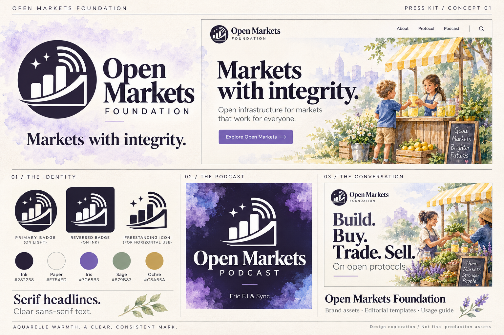
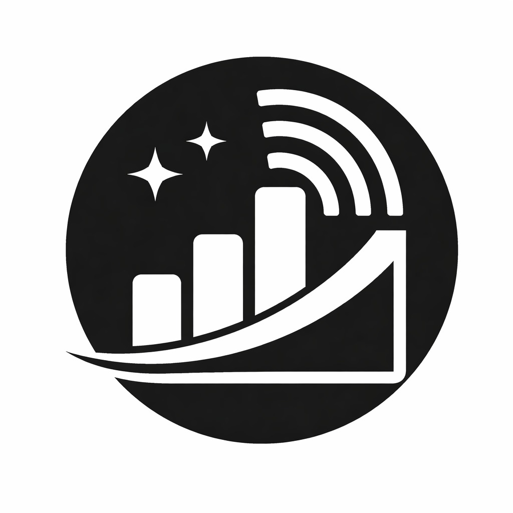
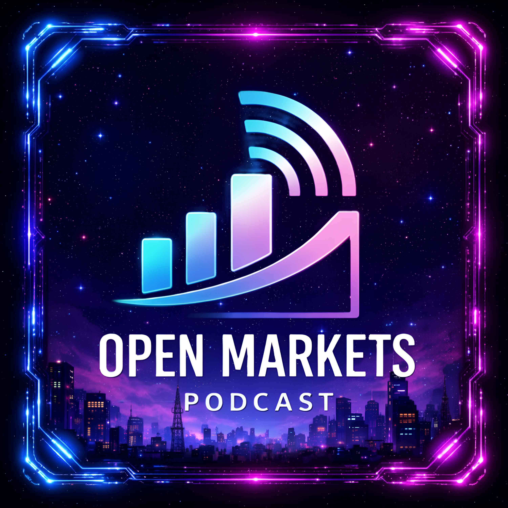

# Open Markets Foundation Press Kit

Brand artwork and visual direction for Open Markets Foundation and the Open Markets Podcast.

[Website](https://openmarkets.pub/) · [GitHub](https://github.com/OpenMarketsFoundation) · [Podcast](https://fountain.fm/show/8aujy1pUxhDKcm0fHcsM) · [Download the kit](https://github.com/OpenMarketsFoundation/presskit/archive/refs/heads/main.zip)

## Visual direction

A crisp ink mark, serif headlines and watercolor illustrations of everyday commerce. The podcast uses a deeper violet treatment within the same visual family.

**Status: concept edition, October 2026.** The board illustrates the proposed identity and applications. It is not a collection of individually editable templates or finished vector logo files. The original artwork below is supplied separately from the concept.

## Downloads

| Asset | Format and dimensions | Download |
| --- | --- | --- |
| Identity concept board | PNG · 1536 × 1024 | [View / save](concepts/open-markets-identity.png) |
| Original monochrome symbol | JPEG · 1024 × 1024 · white background | [View / save](logos/open-markets-original.jpg) |
| Original podcast cover | PNG · 3000 × 3000 | [View / save](podcast/open-markets-podcast-original.png) |
| Color palette | CSS variables | [palette.css](colors/palette.css) |
| Color palette | JSON | [palette.json](colors/palette.json) |
| Identity guidance | Markdown | [BRAND.md](BRAND.md) |

### Original artwork

## Palette

| Color | Hex | Intended role |
| --- | --- | --- |
| Ink | `#282238` | Logo, headings and primary text |
| Paper | `#F7F4ED` | Main background |
| Iris | `#7C65B3` | Brand accent |
| Sage | `#879B83` | Illustration and decorative accents |
| Ochre | `#C8A65A` | Illustration and decorative accents |

These values define the concept palette; rendered swatches in the board are illustrative. Check contrast for each actual text/background pairing.

## Typography

Keep the website's editorial serif headline style and clear sans-serif supporting text. Exact font families, weights and licenses will be documented with the production assets; no font files are included in this edition.

## Next production assets

- [ ] Refined vector logo masters and horizontal/stacked wordmarks.
- [ ] Transparent, black, white and reversed exports.
- [ ] Simplified avatar and favicon artwork, checked at small sizes.
- [ ] Standalone podcast, episode, social and presentation templates.
- [ ] Confirmed typography and font license references.
- [ ] Press boilerplate, fact sheet, approved bios and media contact.
- [ ] Final usage terms and production brand guide.

See [BRAND.md](BRAND.md) for the production brief and [USAGE.md](USAGE.md) for the current asset status.

## Reference

Repository organization takes inspiration from the [HiveTalk press kit](https://github.com/HiveTalk/presskit). Open Markets artwork and colors are provided here; no HiveTalk artwork or fonts are bundled.
