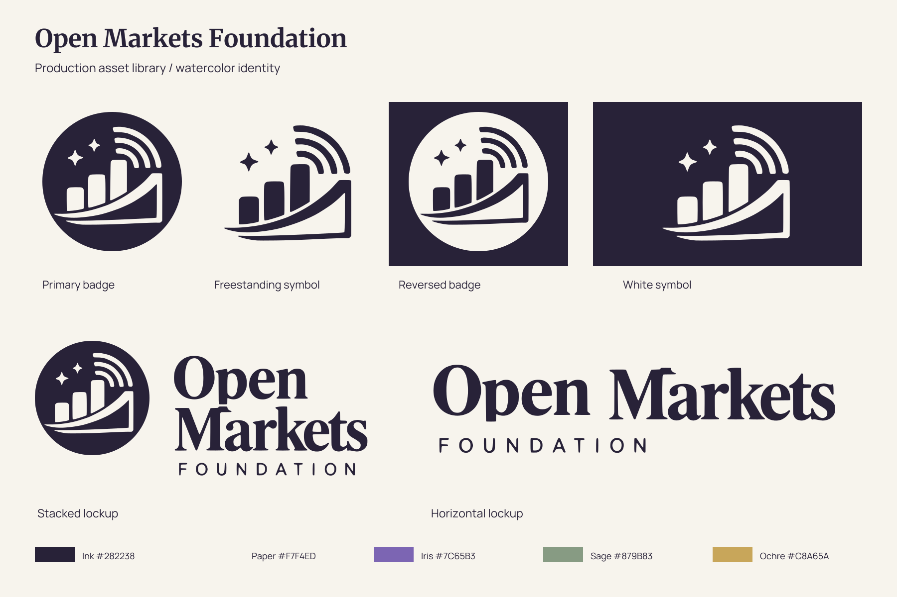
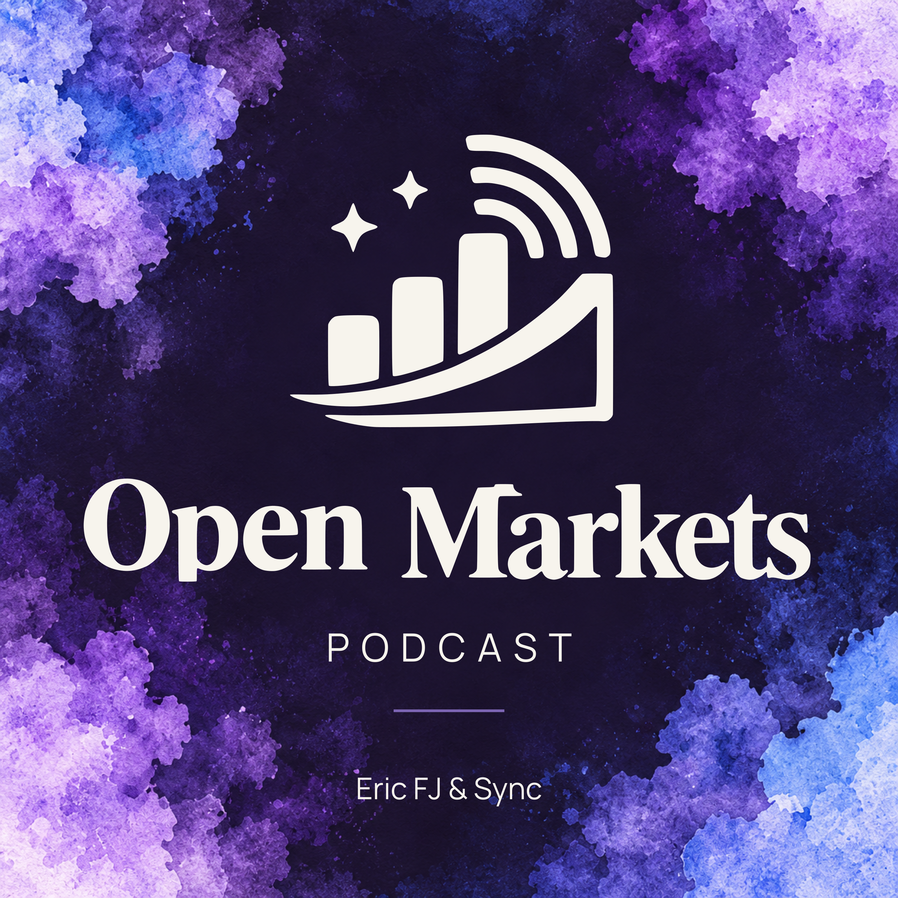
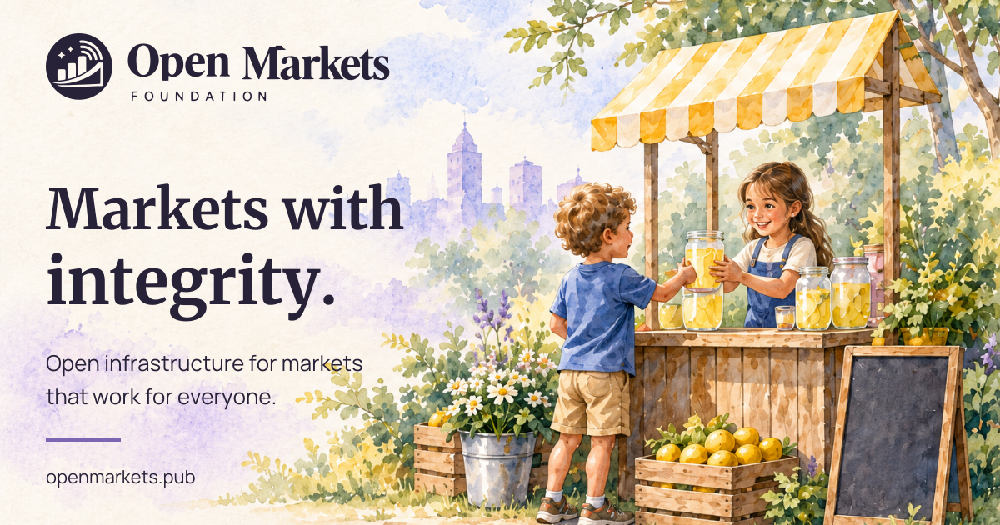

# Open Markets Foundation Press Kit

A complete asset library built from the approved watercolor identity: one symbol, one wordmark, and a consistent theme across foundation and podcast materials.

[Download the full kit](https://github.com/OpenMarketsFoundation/presskit/archive/refs/heads/main.zip) · [Brand guide](brand-guide.pdf) · [Website](https://openmarkets.pub/) · [Podcast](https://fountain.fm/show/8aujy1pUxhDKcm0fHcsM)

## Logos

All variants share the symbol and outlined lettering traced from the [approved mockup](concepts/open-markets-identity.png). SVGs and PDFs contain real vector paths, not embedded logo images. PNGs have transparent backgrounds, including the interior cutouts of the badge.

| Lockup | Ink SVG | Black SVG | White SVG | PNG downloads | Vector PDF |
| --- | --- | --- | --- | --- | --- |
| Badge | [SVG](logos/svg/omf-badge-ink.svg) | [SVG](logos/svg/omf-badge-black.svg) | [SVG](logos/svg/omf-badge-white.svg) | [512](logos/png/omf-badge-ink-512.png) / [2048](logos/png/omf-badge-ink-2048.png) | [PDF](logos/pdf/omf-badge-ink.pdf) |
| Freestanding symbol | [SVG](logos/svg/omf-symbol-ink.svg) | [SVG](logos/svg/omf-symbol-black.svg) | [SVG](logos/svg/omf-symbol-white.svg) | [512](logos/png/omf-symbol-ink-512.png) / [2048](logos/png/omf-symbol-ink-2048.png) | [PDF](logos/pdf/omf-symbol-ink.pdf) |
| Stacked | [SVG](logos/svg/omf-stacked-ink.svg) | [SVG](logos/svg/omf-stacked-black.svg) | [SVG](logos/svg/omf-stacked-white.svg) | [512](logos/png/omf-stacked-ink-512.png) / [2048](logos/png/omf-stacked-ink-2048.png) | [PDF](logos/pdf/omf-stacked-ink.pdf) |
| Horizontal | [SVG](logos/svg/omf-horizontal-ink.svg) | [SVG](logos/svg/omf-horizontal-black.svg) | [SVG](logos/svg/omf-horizontal-white.svg) | [512](logos/png/omf-horizontal-ink-512.png) / [2048](logos/png/omf-horizontal-ink-2048.png) | [PDF](logos/pdf/omf-horizontal-ink.pdf) |

Black and white PNGs and PDFs are also available in the [PNG](logos/png/) and [PDF](logos/pdf/) folders. The numbers in PNG filenames indicate width in pixels. White files are intended for dark backgrounds.

## Podcast and media

- **[Podcast cover](podcast/open-markets-podcast-cover.png):** 3000 × 3000 PNG. [Outlined SVG](podcast/open-markets-podcast-cover.svg) / [editable SVG](templates/open-markets-podcast-cover-editable.svg).
- **[Episode/title card](media/podcast-title.png):** 1920 × 1080 PNG. [Editable SVG](templates/podcast-title-editable.svg).
- **[Intro video](media/open-markets-intro.mp4):** six-second 1920 × 1080 MP4, 30 fps, silent, with fade-in and fade-out. [Media notes](media/README.md).

## Social, website and presentation assets

| Asset | Export | Editable source |
| --- | --- | --- |
| Square social post · 1080 × 1080 | [PNG](social/square.png) | [SVG](templates/square-editable.svg) |
| Link preview · 1200 × 630 | [PNG](social/link-preview.png) | [SVG](templates/link-preview-editable.svg) |
| Story · 1080 × 1920 | [PNG](social/story.png) | [SVG](templates/story-editable.svg) |
| Website hero · 1920 × 1080 | [PNG](website/hero.png) | [SVG](templates/hero-editable.svg) |
| Presentation title · 1920 × 1080 | [PNG](templates/presentation-title.png) | [SVG](templates/presentation-title-editable.svg) |
| Small website icon | [SVG](website/icon.svg) / [16 PNG](website/icon-16.png) / [32 PNG](website/icon-32.png) | Same SVG |
| Larger website icons | [48 PNG](website/icon-48.png) / [180 PNG](website/icon-180.png) / [512 PNG](website/icon-512.png) | [Badge SVG](logos/svg/omf-badge-ink.svg) |

The small icon uses the same traced bars, arrow and inner broadcast arc, with the stars and outer arcs omitted for legibility. The website hero is an artwork/layout asset, not a deployed website.

[Template editing instructions](templates/README.md) · [Standalone watercolor backgrounds](illustrations/) · [Original approved concept](concepts/open-markets-identity.png)

## Typography

**Merriweather** for editorial headlines and **Manrope** for body copy and supporting labels. These families match the font declarations on the Open Markets website inspected on 24 October 2026.

[Download the fonts and licenses](typography/fonts.zip) · [Font sources and installation notes](typography/README.md)

The logo's distinctive lettering is outlined directly from the approved concept; do not retype it. Logo files do not require installed fonts. Editable templates retain live text and use the bundled fonts.

## Color palette

| Color | Hex | Role |
| --- | --- | --- |
| Ink | `#282238` | Mark, headings and primary text |
| Paper | `#F7F4ED` | Main background |
| Iris | `#7C65B3` | Brand accent |
| Sage | `#879B83` | Watercolor and decorative accents |
| Ochre | `#C8A65A` | Watercolor and decorative accents |

[CSS](colors/palette.css) · [SCSS](colors/palette.scss) · [JSON](colors/palette.json) · [Plain text](colors/palette.txt)

## Press information and guidance

[Brand guide PDF](brand-guide.pdf) · [Usage guidance](BRAND.md) · [Press copy and fact sheet](press/README.md) · [Asset rights](USAGE.md) · [Asset inventory and verification](source/README.md)

The previous monochrome upload and neon podcast cover are retained only in [archive](archive/README.md). Use the assets linked above for the watercolor identity.

The packaging structure was informed by the [HiveTalk press kit](https://github.com/HiveTalk/presskit). No HiveTalk artwork is included.
